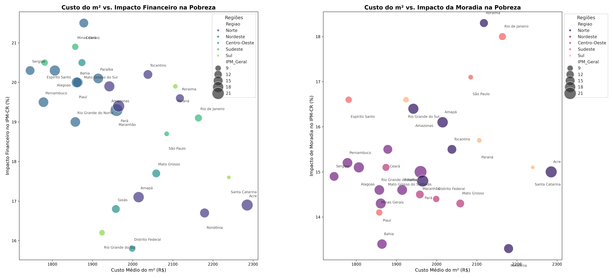

# Custo de construção x pobreza multidimensional nos estados

Estudo exploratório que cruza duas bases do IBGE para responder: **estados onde construir é mais caro são também os mais vulneráveis?**



## Dados

| Base | O que traz | Arquivo |
| :--- | :--- | :--- |
| SINAPI | Custo médio do m² da construção por estado | `custo_moradia.csv` |
| POF 2017-2018 (Tabela 9b) | Índice de Pobreza Multidimensional (IPM-CR) e a contribuição de cada dimensão | `pobreza_ibge.csv` |

## O que o código faz

1. Lê as duas tabelas, que vêm em formatos diferentes (separador, linhas de cabeçalho extras e vírgula decimal).
2. Padroniza os nomes dos estados, converte os números e remove a linha agregada "Brasil".
3. Junta as bases por estado (27 UFs) e adiciona a região.
4. Gera dois gráficos de dispersão: custo do m² contra a dimensão financeira e contra a dimensão moradia do IPM-CR, com o tamanho do ponto proporcional ao índice geral.

## O que os dados mostram

- **Norte e Nordeste concentram a maior pobreza multidimensional** (IPM-CR médio perto de 17%, contra 8% no Sul).
- **O Norte junta duas dificuldades:** está entre as regiões de m² mais caro e de maior pobreza. O Acre tem o m² mais caro do país e um dos índices mais altos.
- **No Nordeste, a dimensão financeira pesa mais que a moradia:** acesso a serviços financeiros e padrão de vida responde, em média, por cerca de 20% do índice, contra cerca de 15% da moradia.
- **O custo do m², sozinho, explica pouco a pobreza geral** (correlação de -0,19 entre custo e IPM-CR).

## Limitações

- As bases são de períodos diferentes (POF 2017-2018 e SINAPI mais recente), então a comparação é indicativa.
- São 27 observações, uma por estado. Serve para levantar hipóteses, não para concluir causa.

## Como executar

```bash
pip install pandas matplotlib seaborn
cd analise_socioeconomica_ibge
python analise.py
```

O gráfico é salvo como `analise_comparativa_ibge.png`.
